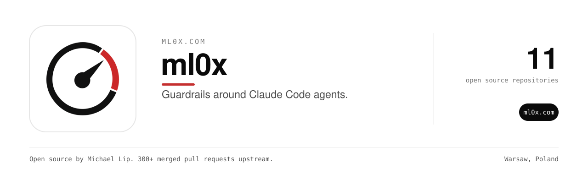

ml0x puts guardrails around coding agents.
An agent run moves through four stages. Analyze, implement, test and review. Each stage has a gate. If a gate fails, the run stops and says why.
Budgets are capped per run, so an agent cannot spend more than you allowed.

### Pipeline

| Repository | What it does |
| --- | --- |
| [100xagenticdev](https://github.com/theluckystrike/100xagenticdev) | The four-stage pipeline for Claude Code with quality gates and budget caps. |
| [gate-contract-rs](https://github.com/ml0x-com/gate-contract-rs) | Fail-closed gate contracts for staged build pipelines, in Rust. |
| [hermes-flash-kit](https://github.com/ml0x-com/hermes-flash-kit) | Harness, cost control and measurement for an agent on a low-cost model. |
| [claude-code-playbook](https://github.com/ml0x-com/claude-code-playbook) | Templates, prompts and configs for Claude Code in production. MIT. |

### Inference arithmetic

Small libraries that answer one sizing question exactly, with the formula in the code.

| Repository | Language | What it answers |
| --- | --- | --- |
| [kv-cache-size-go](https://github.com/theluckystrike/kv-cache-size-go) | Go | How much memory the KV cache and weights need. GQA aware. |
| [KVCacheEstimator](https://github.com/ml0x-com/KVCacheEstimator) | Swift | The same question from a model's config.json. |
| [lora-plan](https://github.com/ml0x-com/lora-plan) | Python | How many parameters a LoRA trains and how much VRAM it needs. |

### Repositories

| Repository | What it does |
| --- | --- |
| [ml0x.com](https://github.com/ml0x-com/ml0x.com) | Machine Learning Cheat Sheet Generator, free printable reference cards for CNN, RNN, Transformers, SVM, Decision Trees, and more. Key formulas, hyperparameters, and Python code snippets. Client-side, no sign-up. |
| [kv-cache-size](https://github.com/ml0x-com/kv-cache-size) | Exact KV-cache arithmetic for transformer inference: bytes per token, total cache bytes, and the context length that fits a memory budget. |
| [llmcost-d](https://github.com/ml0x-com/llmcost-d) | Compute per-call and monthly LLM API cost from token counts and per-million-token pricing |
| [lstm-shapecalc](https://github.com/ml0x-com/lstm-shapecalc) | Rust crate lstm-shapecalc |
| [token-estimate](https://github.com/ml0x-com/token-estimate) | Estimate LLM token counts without loading a tokenizer |

### Sponsor this work

Everything here is free to use. Sponsoring Michael on GitHub pays for the servers, the AI API bills and the hours behind each fix across 12 organizations and 1,800+ public repositories. It starts at $3 a month.

### More open source from the same maintainer

<table><tr><td align="center" width="9%"><a href="https://github.com/zovo-one"> Zovo</a></td><td align="center" width="9%"><a href="https://github.com/notemods"> NoteMods</a></td><td align="center" width="9%"><a href="https://github.com/toolsthatrank"> ToolsThatRank</a></td><td align="center" width="9%"><a href="https://github.com/BeLikeNative"> BeLikeNative</a></td><td align="center" width="9%"><a href="https://github.com/handsofflinks"> handsofflinks</a></td><td align="center" width="9%"><a href="https://github.com/ingredientcalculator"> Ingredient Calculator</a></td><td align="center" width="9%"><a href="https://github.com/lakelevelnow"> LakeLevelNow</a></td><td align="center" width="9%"><a href="https://github.com/seeninaianswers"> Seen in AI Answers</a></td><td align="center" width="9%"><a href="https://github.com/makeroll"> MakeRoll</a></td><td align="center" width="9%"><a href="https://github.com/aiwebsitepipeline"> AI Website Pipeline</a></td><td align="center" width="9%"><a href="https://github.com/worthmyclaim"> WorthMyClaim</a></td></tr></table>

### Maintainer

Built and maintained by [Michael Lip](https://github.com/theluckystrike) in Warsaw, Poland.
He also fixes bugs in projects he uses. He has 300+ merged pull requests in 200+ outside repositories, including [urllib3](https://github.com/urllib3/urllib3/pull/5330), [Appium](https://github.com/appium/appium/pull/22911), [Prefect](https://github.com/PrefectHQ/prefect/pull/21916) and [Google Chrome extension samples](https://github.com/GoogleChrome/chrome-extensions-samples/pull/1629).
Need an engineer for your own product or AI agent? Send a written brief at [axdale.com](https://www.axdale.com/?utm_source=github&utm_medium=org&utm_campaign=hire&utm_content=ml0x-com).
